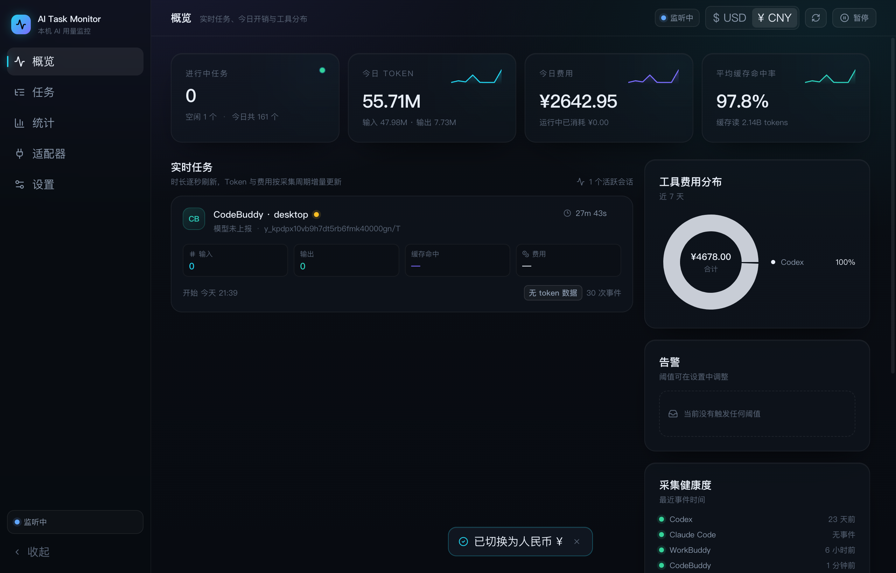

# AI Task Monitor

[](LICENSE)
[](https://www.electronjs.org/)
[](https://www.typescriptlang.org/)
[](#平台支持)

常驻 macOS 菜单栏 / Windows 托盘的桌面监控工具，实时追踪本机 AI 工具正在执行的任务、耗时与 Token 费用，并按工具与任务回溯历史、聚合统计。

覆盖 **Codex、Claude Code、DeepSeek Harness、CodeBuddy、WorkBuddy、Cursor、元宝** 七款工具（桌面端 + 网页端），并预留可扩展适配器接口。



**核心特性**

- **实时**：运行中任务的时长逐秒跳动，Token 与费用按采集周期增量刷新
- **真实**：只读本机已有日志与数据库，不注入进程、不抓包、不改用户配置
- **可解释**：每个数字都能追溯到 `tokensSource`（原生 / 桥接 / 部分 / 不可用），取不到就显示 `—`，绝不估算
- **可扩展**：新增工具只需实现一个 `ToolAdapter` 并注册一行
- **本地优先**：除网页端桥接监听 `127.0.0.1` 外不发起任何网络请求，不上传任何数据

---

## 1. 快速开始

环境要求：Node.js ≥ 20、macOS 12+ 或 Windows 10+。

```bash
npm install --ignore-scripts   # 跳过 better-sqlite3 的 Node 编译
npm run setup                  # 下载 Electron 运行时 + better-sqlite3 的 Electron ABI 预编译产物
npm run dev                    # 开发模式
```

生产构建与打包：

```bash
npm run build          # 编译 main / preload / renderer 到 out/
npm run dist:mac       # 生成 dmg（arm64 + x64）

# 语言包策略：只打包 zh_CN 与 en
#  - electronLanguages: [zh_CN, en]  仅过滤 Windows/Linux 的 locales/*.pak
#  - scripts/after-pack.cjs          删除 macOS 上其余 53 个 *.lproj（约省 30MB）
npm run dist:win       # 生成 nsis 安装包
```

质量校验：

```bash
npm run typecheck      # 主进程 + 渲染进程两套 tsconfig
npm test               # 37 个纯函数/状态机单测
npm run smoke          # 无界面自检：打印适配器状态、汇总与桥接信息后退出
```

> Windows 下 `npm run smoke` 需先设置环境变量：`$env:ATM_SMOKE=1; npx electron out/main/index.js`。

---

## 2. 采集通道（基于本机实测路径）

| 工具 | 数据源 | 通道 | Token 完整度 |
| --- | --- | --- | --- |
| Codex | `~/.codex/sessions/{Y}/{M}/{D}/rollout-*.jsonl` | JSONL 增量 tail，读 `token_count.info.last_token_usage` | 完整：输入 / 输出 / 缓存读 / 缓存写 / 推理 |
| Claude Code | `~/.claude/projects/<slug>/<uuid>.jsonl` | JSONL 增量 tail，逐行累加 `message.usage` | 完整：输入 / 输出 / `cache_read` / `cache_creation` |
| WorkBuddy | `~/.workbuddy/workbuddy.db` → `sessions` + `session_usage`；`~/.workbuddy/sessions/<pid>.json` | 只读 SQLite 轮询 + 会话心跳 | 部分：上下文占用量，**不计价** |
| CodeBuddy | `~/.codebuddy/projects/*.jsonl`；`~/.codebuddy/sessions/<pid>.json` | 文件监听 + 会话心跳（按「项目 + 日期」归并） | 心跳无 token → `unavailable`；jsonl 命中时用原生用量 |
| Cursor | `~/Library/Application Support/Cursor/User/globalStorage/state.vscdb` | 只读 SQLite（`ItemTable`） | 多数情况下不可得（服务端持有） |
| DeepSeek Harness | `~/Library/Application Support/@deepseek-ai/dsh-desktop/Local Storage/leveldb` | LevelDB 快照只读 + 桥接 | 桥接可用；本地解析仅在命中 usage 字段时记录 |
| 元宝 | 无本地会话落盘（实测仅 `.qimei/`、`Documents/`） | 本地 HTTP 桥接 + 用户脚本 | 桥接可用；否则仅记录会话时长 |

### 数据可信度约定

`tokensSource` 显式标注来源，界面据此显示徽标，**绝不用估算值伪造 token**：

- `native` —— 工具本地落盘的完整用量，可按价目表计价
- `bridge` —— 网页脚本上报，可计价
- `partial` —— 只能取到部分字段（如 WorkBuddy 的上下文占用量），**费用显示 `—`**
- `unavailable` —— 无用量来源，仅记录会话时长，费用与命中率显示 `—`

---

## 3. 字段定义与展示格式

| 字段 | 定义 | 展示 |
| --- | --- | --- |
| 开始时间 | 当前活动段首个事件的时间戳 | `今天 20:12` / `昨天 18:40` / `11-03 22:23` |
| 执行时长 | 活动段内 `最后事件 - 首个事件`；运行中为 `当前时间 - 开始时间` | `1h 23m 45s`，不足 1 分钟显示 `45s` |
| 输入 Token | 非缓存命中的新输入 token | `12.4K`（≥1000）/ `1.23M`（≥100 万），悬停显示完整值 |
| 输出 Token | 模型生成 token | 同上 |
| 输入缓存命中率 | `cacheRead / (input + cacheRead + cacheWrite)`，分母为 0 时为空 | `87.3%`，无数据 `—` |
| 输出缓存命中率 | 仅桥接上报可提供，本地日志无此字段 | `—` + tooltip 说明 |
| 当前费用 | 四类 token × 模型单价累加，库里恒为 USD | ≥1 保留 2 位，<1 保留 4 位，符号前置 |
| 状态 | `running` / `idle` / `ended` | 运行中 / 静默 / 已结束（详见下节） |

**任务 = 会话内的一段连续活动（burst）。** 同一会话两次事件间隔超过 10 分钟即切分为新任务，避免跨天会话产生数百小时的荒谬时长。

### 任务状态语义（互斥，不重叠）

| 状态 | 判定条件 | 含义 | 是否计入"进行中" |
| --- | --- | --- | --- |
| 运行中 `running` | 最近 90s 内有新事件 | 正在产生用量 | 是 |
| 静默 `idle` | 90s ~ 30min 无事件 | 仍在进行、只是暂时没有输出（长思考 / 等待输入 / 工具执行中） | 是 |
| 已结束 `ended` | 进程退出、会话结束信号，或静默超过 30 分钟 | 已结算，时长冻结 | 否 |

`idle` 不是终态，它最多维持 30 分钟就会自动转为 `ended`；两者不会同时成立。
概览页的「实时任务」展示 `running + idle`，历史列表默认展示全部三种。<br>
（原标签「空闲」易被误解为"没在跑"，已更名为「静默」。）

### 3.1 事件归属规则（重要）

任务与用量流水是**两层结构**：`tasks` 是按活动段聚合出来的结果，`usage_events` 是不可变的原始事件。
所有区间统计（token / 费用 / 缓存命中）都按事件时间归集，任务数与时长才按任务粒度。

| 情形 | 判据 | 归属 |
| --- | --- | --- |
| 正常续写 | `0 ≤ eventTs - lastEventAt ≤ 10min` | 追加到当前活动段 |
| 开新活动段 | `eventTs - lastEventAt > 10min` | 新任务 `${baseId}~${eventTs}` |
| **历史回填** | `eventTs < startedAt - 10min` | 独立的按天任务 `${baseId}~h<YYYY-MM-DD>`，状态直接结算为 `ended` |
| 心跳 | `skipEventLog: true` | 只刷新活跃度，**不写流水、不改 tokensSource** |

**为什么需要「历史回填」这一档**：Codex / Claude Code 的子代理、续写线程会把旧日志写进同一会话。
如果没有这一档，昨天的几百条事件会被塞进"今天正在跑"的任务里 —— 表现为时间线中出现**昨天的时间**（因为列表只显示时分秒，看起来像未来时间）。

**子线程归并**（目前仅 Codex）：

| `thread_source` | 处理 |
| --- | --- |
| `guardian_review` / `source.subagent.other = guardian` | **完全跳过**，不建任务、不计 token —— 它是执行动作前的内部安全判定 |
| `subagent`（带 `parent_thread_id`） | 事件并入父线程，费用累计到父任务（一次对话只应有一个任务） |
| 其他 / 未知 | 照常记录（宁多不漏，便于发现新类型） |

父线程 / guardian 的判定依赖 rollout 文件**首行**的 `session_meta`。进程重启后文件游标已在末尾，
因此适配器会在首次遇到该文件时**同步回读文件头 32KB**——必须是同步的，否则第一条 `token_count`
会先用文件名派生出子会话 id，父子关系就丢了。

### 3.2 回填与时间展示

- **首次回填窗口 7 天**（按文件 mtime 过滤），偏移量持久化在 `file_cursors`（byte offset + inode）
- 重启只读追加区段；文件被截断或 inode 变化时自动重置游标
- 清空 `file_cursors` 可强制重扫（会重新产生事件，幂等键保证不重复计费）
- 事件时间统一显示为：今天 `11:07:21`、昨天 `昨天 16:53:33`、更早 `11-16 16:53:33` —— **必须带日期**，否则跨天任务的时间线会让人误以为时间错乱

---

## 4. 价目表可信度

价目表每行带 `status`：

- **已核实 `verified`** —— 单价取自厂商官方定价页，行内可直接跳转来源：
  - Anthropic `claude-*`：<https://platform.claude.com/docs/en/about-claude/pricing>
  - OpenAI `gpt-6*`：<https://platform.openai.com/docs/pricing>
  - DeepSeek `deepseek-*`：<https://api-docs.deepseek.com/quick_start/pricing>（取**低谷价**，高峰为 2 倍，已在备注标注）
- **待确认 `pending`** —— 官方 API 定价页未列出，单价强制为 0，任务费用显示 `—`：
  - `codex-*`：Codex 走 ChatGPT 订阅额度，API 页无 token 单价
  - `hy*`（腾讯）、`glm-*`（智谱）：未找到官方公开单价
  - `*` 兜底行：未匹配任何已核实模型

要启用某个待确认模型，只需在设置页填入单价并把状态切为「已核实」，任务费用会立即按新口径重算。

---

## 5. 默认参数

| 项 | 默认值 | 说明 |
| --- | --- | --- |
| 文件监听防抖 | 300 ms | chokidar `awaitWriteFinish` |
| 进程探活 | 5 s | 工具进程存活判定 |
| 桌面端数据库轮询 | 10 s | WorkBuddy / Cursor |
| 界面快照推送 | 2 s（空闲 10 s） | 主进程 → 渲染进程 |
| 菜单栏刷新 | 5 s | 文案变化才重建菜单 |
| 界面计时器 | 1 s | 纯本地，不产生 IPC |
| 空闲判定窗口 | 90 s | 超时无事件转「空闲」，30 分钟后转「已结束」 |
| 告警：费用 | 1 USD 提醒 / 5 USD 警示 | 卡片描边转琥珀 / 红色 |
| 告警：时长 | 30 分钟 / 2 小时 | |
| 告警：缓存命中 | < 30%（样本 ≥1000 token） | |
| 数据保留 | 90 天 | 每 6 小时清理一次 |

全部可在「设置」页实时调整，改动立即生效。

---

## 6. 网页端桥接

元宝与 DeepSeek 网页端的真实用量需要脚本上报到本机端口：

1. 打开「适配器」页，确认桥接显示 `127.0.0.1:43117`（被占用会自动递增）
2. 点击「复制元宝脚本」/「复制 DeepSeek 脚本」
3. 在 Tampermonkey 中新建脚本并粘贴，保存后刷新对应网页
4. 回到「适配器」页，`已接收上报` 计数会增加

安全策略：仅监听 `127.0.0.1`；校验 `X-Bridge-Token`（首次启动生成，存于 `<userData>/monitor/bridge-token`）；Origin 白名单仅 `yuanbao.tencent.com` 与 `chat.deepseek.com`；请求体上限 64 KB；限流 30 req/s。脚本只上报 token 计数与标题，**不读取也不上传任何对话正文**。

---

## 7. 架构

```
adapters（7 个采集器）
   └── collectors（jsonl-tailer / sqlite-reader / leveldb-reader / process-probe）
          └── core（task-machine → pricing → alerts → scheduler → snapshot）
                 └── db（better-sqlite3 WAL：tasks / usage_events / file_cursors / settings / pricing）
                        └── ipc → renderer + 菜单栏
```

- **归一化**：适配器只产出 `UsageDelta`（统一四元组 token + 去重键），不认识数据库与界面
- **零侵入扩展**：新增工具实现 `ToolAdapter` 并在 `src/main/adapters/registry.ts` 注册一行即可
- **幂等**：`usage_events(task_id, dedupe_key)` 唯一索引，重启重读不会重复计费
- **增量读取**：`file_cursors` 持久化字节偏移与 inode，重启只读追加区段；文件截断自动重置游标
- **只读外部库**：`{ readonly: true, fileMustExist: true, timeout: 3000 }`，绝不写入 WorkBuddy / Cursor 的数据库
- **错误隔离**：单个适配器异常按 5s→10s→…→60s 退避重启，不影响其它通道
- **安全**：`contextIsolation` + `sandbox` + `nodeIntegration: false`，preload 白名单暴露 `window.monitor`

---

## 8. 已知限制

1. **元宝** 本地无任何会话/用量落盘，不装脚本时只能记录「进程存活 + 会话时长」，token 全为 `—`。
2. **DeepSeek Harness** 的 Local Storage 无稳定 schema，只有解析出 usage 字段时才记 token。
3. **Cursor** 的 token 用量由服务端持有，本地通常只有会话时间线，费用显示 `—`。
4. **WorkBuddy** 的 `session_usage.used` 是上下文占用量而非计费输入，故按 `partial` 处理且不计价。
5. **回填窗口固定 7 天**（按文件 mtime 过滤）：更早的事件不会自动导入；清空 `file_cursors` 重扫也不会超过该窗口。若需要更早的历史，只能调大适配器里的 `backfillDays` 后重扫。
6. **未知/待确认模型不计价**：费用列显示 `—`，需在设置页补录单价并标记「已核实」后才会计算。
7. **Codex 无 API token 单价**：任务时长与 token 完整，但费用为 `—`，除非手动补录订阅折算价。
8. **心跳通道只有时长**：CodeBuddy / WorkBuddy 的 `<pid>.json` 心跳不含 token，这类任务固定标 `unavailable`。

---

## 9. 目录速览

```
src/shared     types / ipc-contract / format / defaults（前后端共用）
src/main       index / window / tray / runtime / ipc
  ├ core       task-machine / pricing / alerts / scheduler / snapshot / batch-writer
  ├ adapters   7 个工具适配器 + base + registry
  ├ collectors jsonl-tailer / sqlite-reader / leveldb-reader / process-probe / paths
  ├ bridge     server + 用户脚本模板
  └ db         migrations + repositories
src/preload    contextBridge 白名单 API
src/renderer   React 18 + Tailwind + Recharts + Zustand（概览/任务/统计/适配器/设置）
tests          纯函数与状态机单测
scripts        setup-native / generate-icon
```

---

## 10. 隐私与安全

- **默认零联网**：除可选的网页端桥接（仅监听 `127.0.0.1`）外，应用不发起任何网络请求，不上传任何数据
- **只读**：WorkBuddy / Cursor 等外部 SQLite 一律以 `readonly: true` 打开，绝不写入；日志文件只读取增量字节
- **不采集内容**：仅采集时间戳、模型名、token 计数与工作区路径，**不读取 prompt、代码、文件内容**
- **桥接受控**：随机 token 校验 + Origin 白名单 + 64KB 体积上限 + 30 req/s 限流，脚本也只上报计数与标题
- **渲染进程隔离**：`contextIsolation: true`、`sandbox: true`、`nodeIntegration: false`，preload 以白名单暴露 API

发现安全问题请参考 [SECURITY.md](SECURITY.md)，不要直接开公开 issue。

---

## 11. 平台支持

| 平台 | 状态 | 说明 |
| --- | --- | --- |
| macOS 12+ (arm64 / x64) | ✅ 主要开发平台 | 菜单栏常驻，`.dmg` 分发 |
| Windows 10+ (x64) | ✅ 支持 | 托盘常驻，`.exe` 安装包；原生模块需在 Windows 上执行 `npm run setup` |
| Linux | ⚠️ 未验证 | 代码保留平台分支，未做打包与实机测试 |

> 原生模块（better-sqlite3）与平台绑定，跨平台打包请在目标系统上执行 `npm run setup` 后再 `npm run dist:*`。

---

## 12. 参与贡献

欢迎提交 Issue 与 PR：

- 修 bug / 加适配器：请先看 [CONTRIBUTING.md](CONTRIBUTING.md)，里面有「新增一个工具适配器」的完整步骤与代码骨架
- 提交前请确保 `npm run typecheck` 与 `npm test` 通过
- 参与即表示同意遵守 [CODE_OF_CONDUCT.md](CODE_OF_CONDUCT.md)

版本变更见 [CHANGELOG.md](CHANGELOG.md)。

---

## 13. 许可证

本项目基于 [MIT License](LICENSE) 开源，版权归 © 2026 sanwuwy 所有。

```
MIT —— 可自由使用、修改、分发与商用（含闭源分发），保留版权与许可声明即可。
```

选 MIT 的原因很简单：约束最小、被 GitHub 上绝大多数开源项目采用，
二次分发时只需保留一份 LICENSE 声明，不必额外维护 NOTICE 与修改标注。

第三方依赖各自随包分发许可证（见 `node_modules/*/LICENSE`），本项目不做二次声明。

---

## 致谢

- 统计口径参考了 [ccusage](https://github.com/ryoppippi/ccusage) 等本地日志解析类工具的做法：以「单次请求」为原子单位、价目表版本化、未知单价不猜测
- UI 基于 React + Tailwind CSS + [Recharts](https://recharts.org/) + [Zustand](https://github.com/pmndrs/zustand)
- 图标造型取自 [lucide](https://lucide.dev/) 的 `activity`，由脚本按主题色程序化生成
